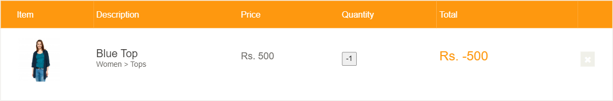
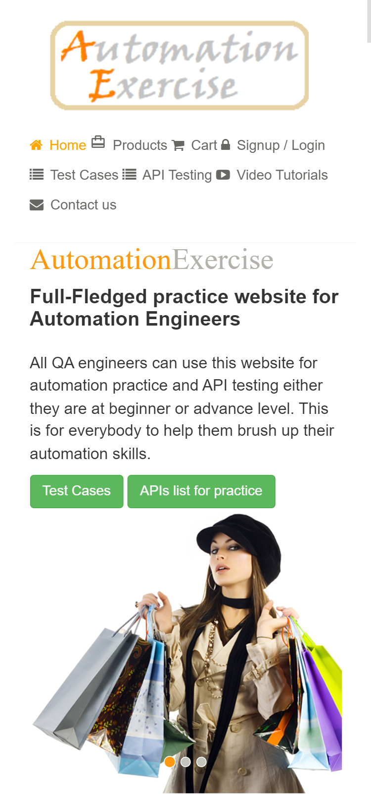

# Defect Reports and Open Questions

Found while running the [UI](../ui/test-cases.md) and [API](../api/test-cases.md) test cases on
7 Nov 2026. API defects include a curl command to reproduce; UI defects include steps and,
where useful, a screenshot in [evidence/](../evidence).

| ID | Title | Severity | Priority | Status |
|---|---|---|---|---|
| AE-UI-003 | Cart accepts zero and negative quantities, giving a negative total | Major | P1 | Open |
| AE-API-001 | Error responses return HTTP 200 instead of the documented 4xx code | Major | P1 | Open |
| AE-API-006 | `createAccount` accepts an email with no valid format | Major | P2 | Open |
| AE-API-005 | API answers over plain HTTP with no redirect or HSTS | Major | P2 | Open |
| AE-UI-002 | Critical accessibility issues: unnamed buttons and an unlabelled field | Major | P2 | Open |
| AE-UI-001 | Payment accepts malformed and expired card details | Minor (risk) | P2 | Open |
| AE-API-002 | JSON responses are sent with `Content-Type: text/html` | Minor | P2 | Open |
| AE-UI-004 | Header menu doesn't collapse on mobile screens | Minor | P3 | Open |
| AE-API-003 | `brandsList` repeats each brand once per product | Minor | P3 | Open |
| AE-API-004 | `Allow` header lists methods the endpoint rejects | Trivial | P3 | Open |

---

## AE-UI-003 · Cart accepts zero and negative quantities, giving a negative total

| | |
|---|---|
| Severity / Priority | Major / P1 |
| Found by | UI-CART-03 |
| Environment | Chrome 130, Windows 11, 7 Nov 2026 |

**Steps**
1. Open https://automationexercise.com/product_details/1 (Blue Top, Rs. 500).
2. Replace the quantity with `-1` and click "Add to cart".
3. Open the cart.

**Expected:** quantities below 1 are rejected or reset to 1.

**Actual:** the cart shows Blue Top with quantity **-1** and a line total of **Rs. -500**. A
quantity of `0` adds a line with Rs. 0. `1000000` is also accepted (Rs. 500,000,000) with no cap.
The request sent is simply `/add_to_cart/1?quantity=-1`, so neither the page nor the server checks it.



**Impact:** in a real shop a negative line could reduce the order total, which is a direct
revenue risk. Server-side validation is needed, not just a `min` attribute on the field.

---

## AE-API-006 · `createAccount` accepts an email with no valid format

| | |
|---|---|
| Severity / Priority | Major / P2 |
| Found by | API-ACC-04 |

**Steps**
```bash
curl -s -X POST https://automationexercise.com/api/createAccount \
  -d "name=Test&email=not-an-email-123&password=Secret%23123&title=Mr&birth_date=1&birth_month=May&birth_year=1990&firstname=Te&lastname=St&company=x&address1=x&address2=&country=Canada&zipcode=x&state=x&city=x&mobile_number=1"
```

**Expected:** 400 with a message that the email is invalid; no account created.

**Actual:** `{"responseCode": 201, "message": "User created!"}`. The account exists and can be
used with `verifyLogin`. (The test account was deleted immediately afterwards.)

**Impact:** accounts that can never receive email (order confirmations, password resets). The
web signup form does block invalid emails in the browser, so the API is the weaker path.

---

## AE-UI-002 · Critical accessibility issues: unnamed buttons and an unlabelled field

| | |
|---|---|
| Severity / Priority | Major / P2 |
| Found by | UI-NFR-04 (axe-core, WCAG 2.0/2.1 A and AA rules) |

**Steps:** run an axe scan on the home page, `/product_details/1` and `/login`.

**Expected:** no critical violations.

**Actual:** `button-name` (critical) on all three pages: icon-only buttons such as the
subscription arrow have no accessible name, so a screen reader announces just "button".
`label` (critical) on the product page: a form field has no associated label.

**Impact:** screen-reader users can't tell what these controls do. This fails WCAG 4.1.2
(Name, Role, Value) and 1.3.1 (Info and Relationships).

---

## AE-UI-001 · Payment accepts malformed and expired card details

| | |
|---|---|
| Severity / Priority | Minor on a demo site / P2 as a risk |
| Found by | UI-CHK-06 |

**Steps:** log in, add a product, proceed to payment, then pay with card number `abcd`
(other fields valid). Repeat with CVC `1`, and with expiry `01 / 2020`.

**Expected:** each attempt is refused with a clear message.

**Actual:** "ORDER PLACED!" every time.

**Impact:** no card is charged on this demo, so it isn't harmful here. It's raised so that any
real payment integration adds format, Luhn and expiry checks before the request is sent.

---

## AE-UI-004 · Header menu doesn't collapse on mobile screens

| | |
|---|---|
| Severity / Priority | Minor / P3 |
| Found by | UI-NFR-02 |

**Steps:** open the home page at 375 × 812 (iPhone X size in DevTools).

**Expected:** the header links collapse into a menu button.

**Actual:** all 8 links stay visible and wrap over three rows, pushing the page content down.
There's no horizontal scrolling, so the site remains usable.



---

## AE-API-001 · Error responses return HTTP 200 instead of the documented 4xx code

| | |
|---|---|
| Severity / Priority | Major / P1 |
| Found by | 15 cases, e.g. API-PRD-04, API-SRC-05, API-LGN-05, API-ACC-01, API-ACC-07 |
| Environment | Production, 7 Nov 2026, curl 8.x |

**Steps**
```bash
curl -i -X POST https://automationexercise.com/api/productsList
curl -i -X POST https://automationexercise.com/api/searchProduct
```

**Expected:** HTTP 405 for the first call and HTTP 400 for the second, as stated in the API list.

**Actual:** both return `HTTP/1.1 200 OK`. The intended code only appears inside the body:
```json
{"responseCode": 405, "message": "This request method is not supported."}
```

**Impact:** clients, gateways and monitoring that rely on the HTTP status treat every error as
success. Any consumer has to parse the body to find out whether a call failed.

---

## AE-API-002 · JSON responses are sent with `Content-Type: text/html`

| | |
|---|---|
| Severity / Priority | Minor / P2 |
| Found by | API-GEN-01 (all endpoints tested) |

**Steps**
```bash
curl -s -D - -o /dev/null https://automationexercise.com/api/productsList
```

**Expected:** `Content-Type: application/json`

**Actual:** `Content-Type: text/html; charset=utf-8`, while the body is JSON.

**Impact:** HTTP clients that parse by content type (and browsers rendering the response)
treat the payload as HTML. Tools like Postman don't pretty-print or validate it as JSON by default.

---

## AE-API-003 · `brandsList` repeats each brand once per product

| | |
|---|---|
| Severity / Priority | Minor / P3 |
| Found by | API-BRD-02 |

**Steps:** `curl -s https://automationexercise.com/api/brandsList`, then count distinct `brand` values.

**Expected:** one entry per brand (8 brands appear in the web shop's Brands sidebar).

**Actual:** 34 entries, one for every product, with only 8 distinct brand names. "Polo" alone
appears six times, with ids 1, 8, 29, 30, 33 and 37.

**Impact:** a client building a brand filter from this endpoint shows duplicates, and the ids
don't identify a brand.

---

## AE-API-004 · `Allow` header lists methods the endpoint rejects

| | |
|---|---|
| Severity / Priority | Trivial / P3 |
| Found by | API-GEN-02 |

**Steps:** `curl -I https://automationexercise.com/api/productsList`

**Expected:** `Allow: GET` (plus HEAD/OPTIONS if supported).

**Actual:** `HTTP/1.1 405` with `Allow: GET, OPTIONS, PUT, POST, DELETE`, yet POST, PUT and
DELETE all answer "This request method is not supported."

**Impact:** misleading for API discovery tools and for anyone reading the headers.

---

## AE-API-005 · API answers over plain HTTP with no redirect or HSTS

| | |
|---|---|
| Severity / Priority | Major / P2 |
| Found by | API-GEN-03 |

**Steps**
```bash
curl -s -D - -o /dev/null http://automationexercise.com/api/productsList
curl -s -D - -o /dev/null https://automationexercise.com/api/productsList | grep -i strict-transport
```

**Expected:** the http:// call is redirected (301/308) to https://, and HTTPS responses include
`Strict-Transport-Security`.

**Actual:** http:// returns `200 OK` with the full product list; no HSTS header on HTTPS.

**Impact:** for a real shop this matters most on the account endpoints, which take email and
password as form data: on plain HTTP they would travel unencrypted.

---

## Open questions for the product owner

These aren't clearly defects because the behaviour isn't specified. They need a decision.

| ID | Question | Observed | Case |
|---|---|---|---|
| Q-01 | Should search match on category as well as product name? | Searching "top" returns two shirts because their category is "Kids > Tops & Shirts" | API-SRC-01 |
| Q-02 | What should an empty `search_product` return? | All 34 products. A missing parameter returns an error, but an empty one doesn't | API-SRC-04 |
| Q-03 | Should price be numeric in the API? | `"price": "Rs. 500"`: currency and amount in one string, so clients must parse it | API-PRD-02 |
| Q-04 | Is "Account not found!" the intended reply to a wrong password on update/delete? | The account exists. A generic message avoids revealing which emails are registered, but "not found" may confuse legitimate users | API-ACC-09, API-ACC-10 |
| Q-05 | Should an empty search show a "no products found" message? | The page shows only the "SEARCHED PRODUCTS" heading with nothing under it | UI-PROD-04 |
